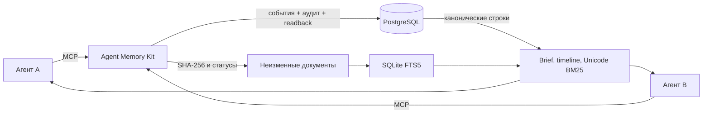

# Agent Memory Kit

Небольшой самостоятельный MCP-сервер для общей памяти проектов и документов агентской команды. Он позволяет разным агентам читать одну каноническую историю, дополнять её событиями и восстанавливать контекст без пересказа прошлых чатов.

**В базовую установку входят PostgreSQL, FastMCP, STDIO-мост, лексический поиск, синтетический корпус знаний и проверка резервного восстановления. Внешняя LLM не требуется.**

## Что уже реализовано

- Канонический append-only журнал событий и аудит в PostgreSQL.
- Повтор UUID с тем же содержимым без дубля, конфликт при другой полезной нагрузке.
- Исправления через `supersedes_id` с сохранением полной истории.
- Детерминированные brief, timeline и поиск по исходным событиям.
- Восемь MCP-инструментов для памяти и версионированных документов.
- Bearer-токены с областями чтения/записи и ограничениями по проекту/приложению.
- HTTP и STDIO, включая мост с запретом редиректов и автоматических повторов.
- Реальный COMMIT-ACK-loss fixture и изолированное восстановление PostgreSQL.

Mem0, FastEmbed, Qdrant, Sleep и облачные провайдеры намеренно не входят в базовую версию. Их возможные расширения перечислены в [roadmap](docs/roadmap.md).

## Архитектура



Главная граница: **каноническая запись не зависит от поискового индекса или модели**. Brief и поиск всегда возвращают исходные события. Подробнее — в [архитектуре и взаимосвязях](docs/architecture.md).

## Быстрый старт

### Требования

- Docker с поддержкой BuildKit;
- Docker Compose v2;
- Python 3.12 только для локального bridge и вспомогательных скриптов;
- Unix-совместимая оболочка для `ci/verify.sh`.

Хостовые Python-зависимости для сервера не нужны: он собирается в контейнере.

### 1. Подготовьте конфигурацию

```sh
cp .env.example .env
```

Все значения в `.env.example` синтетические и предназначены только для демо. Не используйте их с реальными данными. Правила замены описаны в [безопасности](docs/security.md).

### 2. Запустите PostgreSQL, миграции, seed и MCP

```sh
docker compose up --build -d
```

Проверьте health:

```sh
curl --fail http://127.0.0.1:8775/health
```

MCP доступен по адресу `http://127.0.0.1:8775/mcp` только на loopback. PostgreSQL не публикуется на host.

### 3. Выполните настоящий MCP smoke

```sh
docker compose --profile test run --rm smoke
```

Smoke проверяет:

- ровно восемь инструментов для writer и семь для reader;
- `get_work_context` и чтение документов;
- создание, readback, повтор и конфликт UUID;
- подтверждённую коррекцию и полную хронологию;
- запрет записи для reader;
- запрет доступа из другого проекта;
- отказ неверной аутентификации.

### 4. Проверьте резервное восстановление

```sh
PYTHONPATH=src python3 -m agent_memory_kit.backup
```

Скрипт создаёт дамп и манифест, восстанавливает его в новый одноразовый PostgreSQL и сравнивает `id`/`payload_hash`. Успешный результат находится в `backups/<timestamp>/receipt.json`.

### 5. Запустите полный набор проверок

```sh
ci/verify.sh
```

Скрипт использует отдельный Compose-проект `agent-memory-kit-verify`, выполняет unit/integration tests, HTTP smoke и restore acceptance, затем удаляет только свои ресурсы.

## Демонстрационные принципалы

| Принципал | Права | Область |
|---|---|---|
| `demo-reader` | Все операции чтения | Проект 1, `demo-app` |
| `demo-writer` | Чтение и добавление событий | Проект 1, `demo-app` |
| `other-writer` | Чтение и добавление событий | Проект 2, `other-app` |

Токены находятся в локальном `.env`, а в `content/principals.json` — только их хэши. Токены из примера публичны и не являются секретами. Замените их при любом другом использовании.

## MCP-инструменты

| Инструмент | Назначение |
|---|---|
| `get_work_context` | Выбрать проект, приложение и документы для задачи |
| `read_document` | Прочитать документ из неизменного снимка постранично |
| `search_knowledge` | Найти документ через SQLite FTS5 |
| `get_project_brief` | Получить детерминированную сводку без LLM |
| `get_project_timeline` | Пройти полную хронологию, включая исправления |
| `read_project_memory` | Прочитать исходное событие по UUID |
| `search_project_memory` | Найти события через Unicode BM25 |
| `record_project_memory` | Добавить событие с идемпотентной записью и readback |

Сигнатуры, поля и ошибки описаны в [протоколе](docs/protocol.md).

## Подключение агентов

Для Claude Code и Codex предусмотрен STDIO-мост с токеном в owner-only `client.json`. Пример:

```sh
claude mcp add --transport stdio agent-memory -- \
  /absolute/path/agent-memory-kit/.venv/bin/agent-memory-bridge \
  --config /absolute/path/agent-memory-kit/client.json
```

```sh
codex mcp add agent-memory -- \
  /absolute/path/agent-memory-kit/.venv/bin/agent-memory-bridge \
  --config /absolute/path/agent-memory-kit/client.json
```

Подготовка bridge, проверка конфигурации и сценарий работы двух агентов — в [руководстве по клиентам](docs/clients.md). Файл `examples/AGENTS.md` задаёт цикл «начало работы → чтение → запись результата → восстановление».

## Типовой рабочий цикл

1. Агент определяет репозиторий, приложение и полный Git SHA.
2. `get_work_context` возвращает обязательные и справочные документы.
3. `get_project_brief` восстанавливает последние решения и handoff.
4. При необходимости агент проходит `get_project_timeline` или выполняет поиск.
5. После значимого события он сохраняет UUID и полезную нагрузку вне Git, затем вызывает `record_project_memory`.
6. При неизвестном исходе он сначала читает исходный UUID и не создаёт новый автоматически.
7. Исправление оформляется новым событием `correction`, а не редактированием истории.

Память предоставляет датированный контекст и не даёт разрешения на деплой, отправку сообщений или изменение других систем.

## Структура репозитория

```text
src/agent_memory_kit/  # MCP, хранилище, поиск, документы, bridge, backup
migrations/            # схема PostgreSQL
content/               # синтетический реестр, документы и хэши токенов
schemas/               # JSON Schema конфигурации
examples/              # событие, клиент и инструкции для агентов
scripts/               # smoke, hash, public-safety и restore acceptance
tests/                 # unit и integration tests
docs/                  # архитектура, протокол, клиенты, безопасность, операции
ci/verify.sh           # полная self-hosted проверка
```

## Документация

- [Архитектура и взаимосвязи](docs/architecture.md)
- [Протокол и ошибки](docs/protocol.md)
- [Подключение клиентов](docs/clients.md)
- [Безопасность и границы доверия](docs/security.md)
- [Эксплуатация и восстановление](docs/operations.md)
- [Проверка и приёмка](docs/verification.md)
- [Ограничения](docs/limitations.md)
- [Roadmap](docs/roadmap.md)
- [Участие в разработке](CONTRIBUTING.md)

Сопутствующий материал по выпуску и эксплуатации: [Studio CI Playbook](https://github.com/max-panfilov/studio-ci-playbook).

## Ограничения, которые важно знать

Это небольшой проверяемый стартовый набор, а не готовая production-платформа. Brief и поиск ограничены 1 000 событиями, проверка секретов частична, модель доступа рассчитана на доверенную группу, внешнее резервное хранилище и персональные ACL не настроены. Полный список — в [ограничениях](docs/limitations.md).

## Лицензия

MIT. См. [LICENSE](LICENSE).
