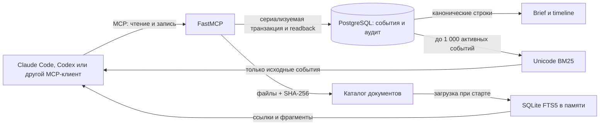
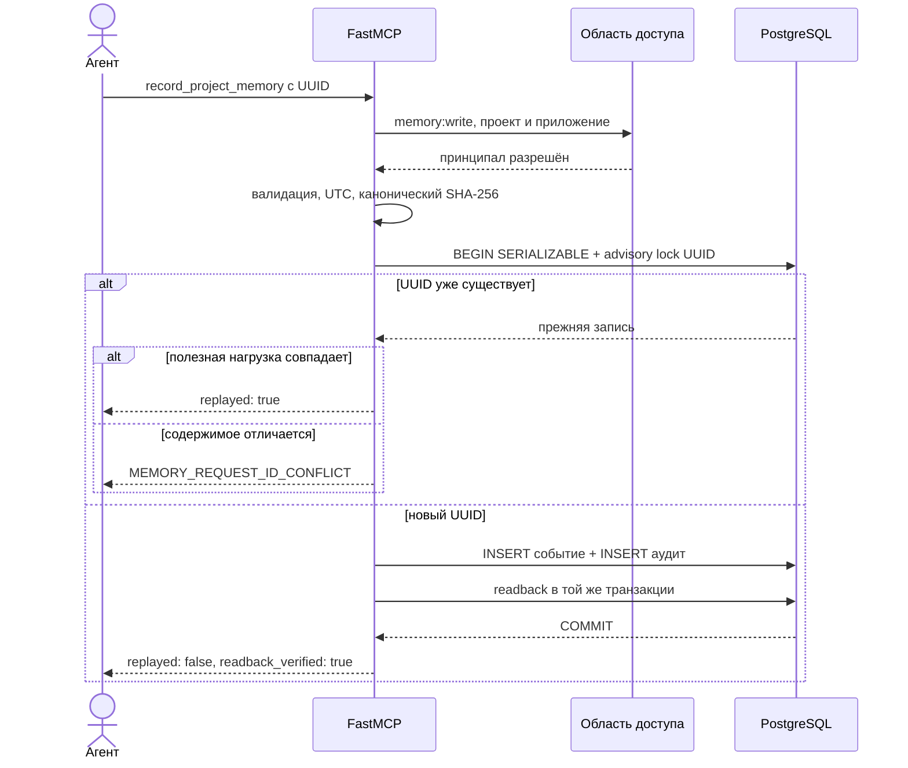
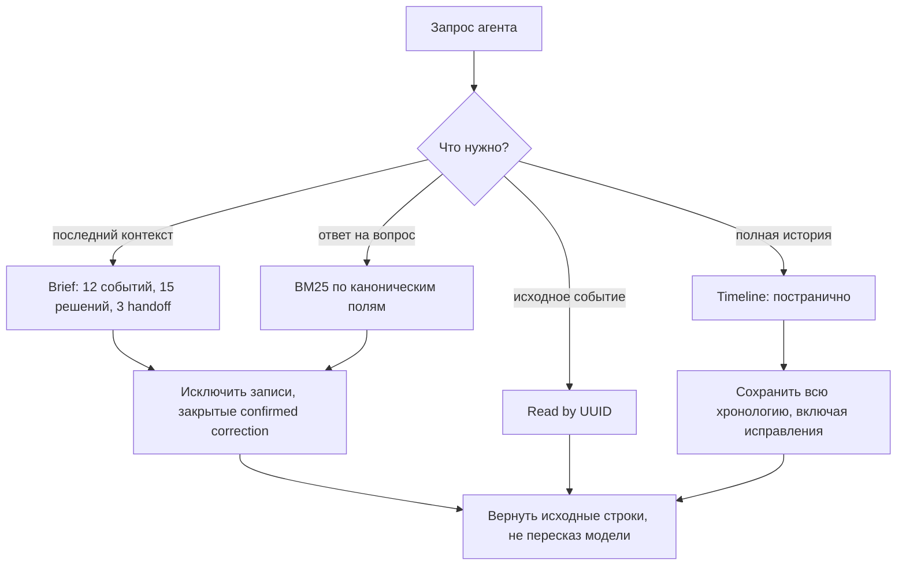
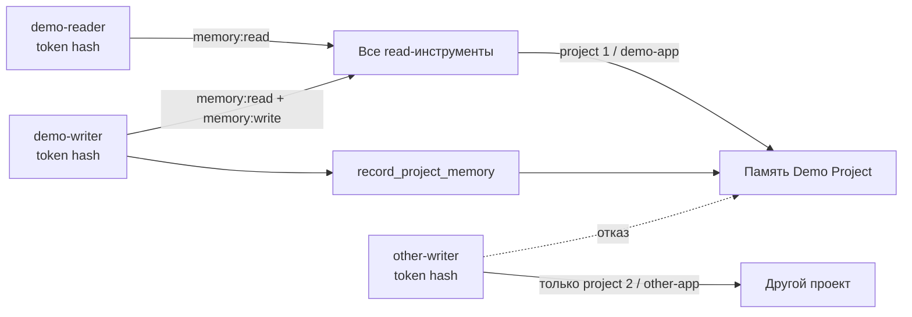
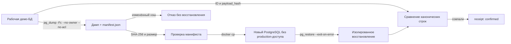

# Архитектура и взаимосвязи

## Принцип устройства

Agent Memory Kit разделяет канонические факты, производные представления и полномочия агента. PostgreSQL хранит исходные события. Краткая сводка и поиск строятся по этим событиям заново и не становятся отдельными источниками истины. Документы читаются из неизменного снимка с проверенными хэшами.

Внешняя LLM, векторная база и облачный провайдер не нужны.

| Компонент | Назначение | Чего не делает |
|---|---|---|
| `server.py` | Регистрирует восемь инструментов, HTTP/STDIO и `/health` | Не вызывает LLM и не выполняет бизнес-команды |
| `auth.py` | Проверяет токены и выбирает принципала | Не создаёт персональные ACL и не изолирует процессы |
| `memory.py` | Валидирует события и строит детерминированные представления | Не генерирует текст памяти |
| `repository.py` | Записывает события и аудит, читает хронологию | Не повторяет запись после неизвестного исхода |
| `knowledge.py` | Проверяет каталог, снимок и поиск документов | Не загружает частный реестр студии |
| `bridge.py` | Преобразует STDIO в Streamable HTTP | Не повторяет запросы и не следует редиректам |
| `backup.py` | Проверяет дамп и восстановление в новый контейнер | Не заменяет внешнее хранилище резервных копий |

## Запись события

Хэш вычисляется по каноническому JSON без `recorded_at`, `shared_safe` и самого `payload_hash`. Эквивалентные метки времени с разными смещениями приводятся к UTC и дают одинаковый хэш.

### Неизвестный исход

Если соединение потеряно вокруг фиксации транзакции, сервер возвращает `MEMORY_WRITE_OUTCOME_UNKNOWN`. Он не выполняет вторую запись. Агент сначала вызывает `read_project_memory` с исходным UUID. Если запись существует, безопасен повтор с тем же UUID и той же полезной нагрузкой. Новый UUID мог бы создать дубль.

## Чтение и поиск

Brief и поиск читают не более 1 000 событий и выставляют `history_truncated`, если существуют более старые записи. Timeline остаётся способом пройти всю историю.

## Области доступа

Принципал ограничен проектом и приложением. Чтение чужой записи и запись в чужую область возвращают одинаковую ошибку доступности, без раскрытия содержимого.

STDIO не использует bearer-токен. Для него явно выбирается `AGENT_MEMORY_STDIO_CLIENT_ID`; такой режим предназначен для доверенного локального процесса.

## Неизменный снимок документов

Каталог `content/documents.json` связывает идентификатор документа с версией, статусом, путём и SHA-256. При старте каждый файл проверяется. У документа `approved` дополнительно проверяется `approval.content_sha256`.

Идентификатор снимка вычисляется по реестру и хэшам документов. Запрос со старым `snapshot_id` возвращает `CONTENT_VERSION_GONE`, а не смешанную версию. Поиск использует SQLite FTS5 в памяти; файлы Markdown остаются источником содержимого.

## Резервная копия и восстановление

Проверка подтверждает только конкретный дамп и конкретное восстановление. Она не создаёт расписание, шифрование, внешнюю копию или межсистемную атомарность.
